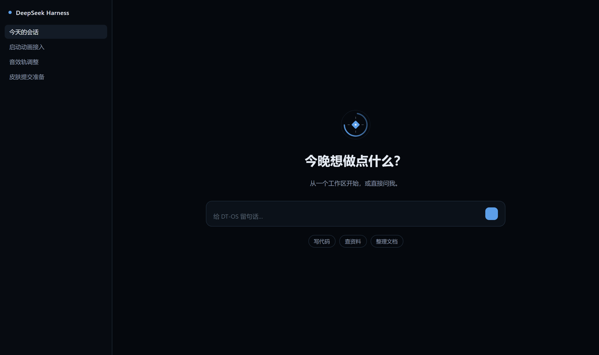
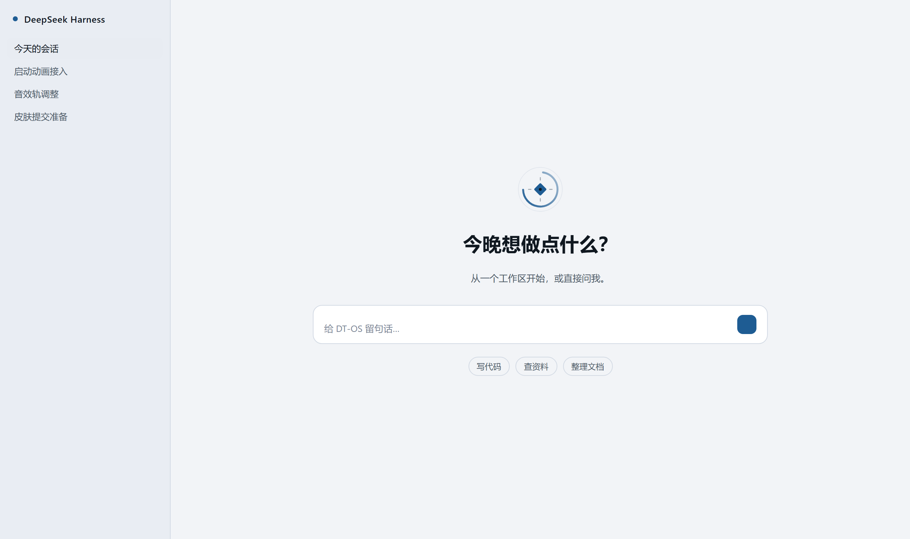

# DT-OS Skin

一个 DeepSeek Harness Web 皮肤：把《底特律：变人》开机界面的冷感,装进你每天用的会话界面。

深色时是深蓝黑底 + 冷蓝高光，浅色时是冷灰白底 + 藏蓝强调色；空白会话页的头像位置换成一枚**断口圆环**——仿生人状态环的形状，缺口落在右上，用四个刻度点和中心菱形把「已启动、待命」的状态说清楚。

<p align="center">
  
  
</p>

## 它改了什么

只有两件事，都走宿主自己的扩展点：

| 部分 | 做法 |
| --- | --- |
| 配色 | 用 `theme.overrideTokens` 覆盖 14 个主题令牌，深/浅两套各自给值。宿主主题保留，皮肤只是一层叠在上面，卸载即还原。 |
| 品牌标记 | 注册到 `conversation.hero.brand.mark` 插槽，替换空白会话页头像前的标记。 |

不动宿主的布局、不追加根节点、不读别的插件的 DOM。所有控件继承宿主令牌，所以色盲/高对比设置、字号设置都照常生效。

## 安装

这个包**没有发布到 npm**，请按 GitHub 仓库安装。`<40 位 commit>` 换成本仓库的完整 commit SHA（`git rev-parse HEAD`）：

```sh
dsh plugin --profile web add "github:2856964164-lab/deepseek#<40 位 commit>"
```

装完在「设置 → 外观」里切换深色/浅色，皮肤会自动跟随。

卸载：

```sh
dsh plugin --profile web remove dsh-skin-android-boot
```

> 为什么不用 `@latest`：npm 上没有同名包，写 `dsh-skin-android-boot@latest` 会直接失败。装 GitHub 源时锁完整 commit 是 DSH 插件的要求——短 SHA 和分支名都不行。

## 兼容性

- 需要 DSH Web `^0.1.0-rc.6`（基于 0.1.0-rc.8 实测）。依赖两个宿主能力：`theme.overrideTokens` 与 `conversation.hero.brand.mark` 插槽，两者在 0.1.0-rc.6 起提供。
- 仅 `web` 平台，不适用于其他宿主。

> 如果用的版本比这个新、但皮肤没有生效，通常是宿主改过令牌名或插槽名。先确认 `dsh --version`，再对照 `client.js` 里的 `TOKEN_MAP`。

## 调色板

| 用途 | 深色 | 浅色 |
| --- | --- | --- |
| 底 | `#05080D` | `#F2F4F7` |
| 一级面 | `#0B1119` | `#FFFFFF` |
| 二级面 | `#131B26` | `#E8ECF2` |
| 品牌强调 | `#5C9EE8` | `#1E5C93` |
| 主文本 | `#E4EAF2` | `#101820` |
| 次文本 | `#8D9AAB` | `#4A5766` |

浅色不是深色的减淡版，是单独调的：藏蓝强调在白面上要比亮蓝深一档才够对比，主文本压到 `#101820` 才在 `#F2F4F7` 上稳过正文对比度。

## 名字

`dsh-skin-android-boot` 是包名（市场里的 `package` 字段由 CI 从 `package.json` 读取，不用在条目里写）。显示名是 **DT-OS Skin / DT-OS 皮肤**。

「DT」来自 Detroit，图标和空白页的圆环用的是同一个造型。

## License

MIT

---

收录不等于安全认证。本项目未被 DSH 官方、安全团队或任何市场背书。